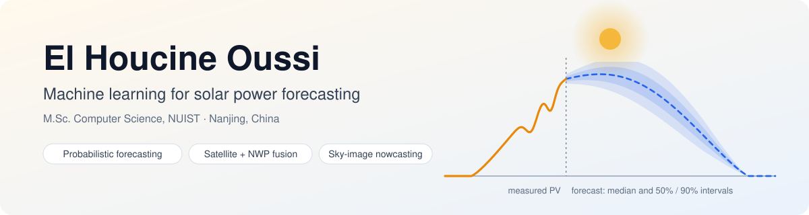
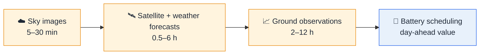

<picture>
  <source media="(prefers-color-scheme: dark)" srcset="assets/banner-dark.svg">
  
</picture>

  

<!-- Add when ready:

-->

### 🎓 Seeking a fully funded PhD position from 2027 in solar and renewable energy forecasting

---

## 👋 About me

I'm an M.Sc. student in Computer Science at **Nanjing University of Information Science and Technology (NUIST)**, China.
My research asks a practical question: **which learned solar forecasts actually beat simple references, at which horizon,
and when does better accuracy turn into better decisions?**

- 🔭 **Now:** running the final held-out test of a 4–6 h satellite + weather-forecast model for 50 Australian solar farms
- 🛠️ **Background:** software engineer (C#/.NET, Java, Flutter) turned forecasting researcher
- 🌍 **Languages:** Arabic · English · French · Mandarin (HSK 3)

## 🔬 Research at a glance

| | Study | Horizon | Data | Status |
|:--:|---|:--:|---|:--:|
| ☁️ | **Sky-image nowcasting** – do sky images add value beyond recent PV history? | 5–30 min | Stanford SKIPP'D |  |
| 🛰️ | **Solar farms up to 6 h ahead** with Himawari / Meteosat imagery and issued weather forecasts | 0.5–6 h | 50 Australian solar farms (AEMO) · 94 UK virtual farms |  |
| 📈 | **Reference specification and model updating** – how much do references, retraining and calibration change measured skill? | 2–12 h | DKASC Alice Springs · 31 HKUST rooftops · NREL PVDAQ 9068 |  |
| 🔋 | **From forecast quality to value** – probabilistic forecasts for home-battery scheduling | day-ahead | 91,290 simulated scenarios · 40 Ausgrid households |  |

### How the studies fit together

From minutes to a day ahead: which inputs help at which horizon, and when forecast accuracy becomes operational value.

<b>💡 Findings so far</b> (click to open)

 

- Specifying the smart-persistence reference correctly cut reported skill at the Hong Kong testbed from **54–57% to 7–13%**.
- Monthly retraining gave six-hour gains over previous-day persistence of **+6.9%** (HKUST) and **+10.0%** (PVDAQ 9068, 2023).
- A battery scheduler that uses the full forecast distribution **lowered cost for all 40 real households** tested.
- Sky images gave **no established gain** over a PV-history LightGBM model on SKIPP'D – a negative result I report as one.

## 🧪 How I work

| 🔒 Fixed plans | 📏 Honest statistics | ♻️ Reproducible code |
|---|---|---|
| Analysis plans written before the final test; held-out test sets scored once | Paired bootstrap confidence intervals, Holm correction, negative results kept | pytest suites, checksum manifests, pinned environments |

## 🧰 Toolbox

  

## 📝 Manuscripts

- **Reference specification, model updating and calibration population in hourly photovoltaic power forecasting** – manuscript prepared for submission (2026)
- **When do probabilistic solar forecasts earn their keep? Forecast quality, distributional validity and operational value in behind-the-meter battery scheduling** – manuscript complete (2026)

## 📂 Code

Code for each study will be published here together with its paper.
Earlier software projects: [HomeRealm](https://github.com/Oussi108/HomeRealm) · [Project_petshop_JEE](https://github.com/Oussi108/Project_petshop_JEE) · [taskwithauthdotnet](https://github.com/Oussi108/taskwithauthdotnet)

---

Open to PhD positions, research collaborations and questions about solar forecasting – feel free to reach out.

