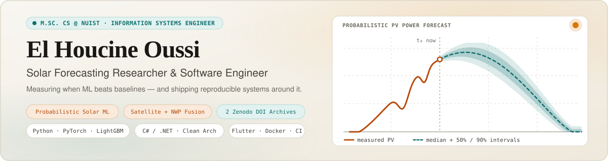
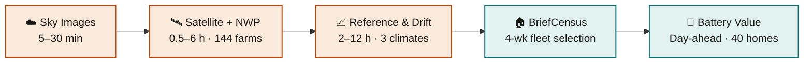

<picture>
  <source media="(prefers-color-scheme: dark)" srcset="assets/banner-dark.svg">
  
</picture>

  

 

 

**Open to Software Engineering, Machine Learning Engineering & Applied Research Roles · Global / Remote**

 

<picture>
  <source media="(prefers-color-scheme: dark)" srcset="assets/highlights-dark.svg">
  
</picture>

---

## 👋 About Me

I'm an M.Sc. student in Computer Science at **Nanjing University of Information Science and Technology (NUIST)** working with Prof. Ling Tan, and a State Engineer in Information Systems (**SUPMTI**, Morocco).

I bridge **empirical ML research** and **production software engineering** — running scientific experiments with the same discipline used to ship reliable software: pre-registered protocols, byte-identical reruns, SHA-256 checksum manifests, and automated `pytest` suites.

<table>
<tr>
<td width="50%" valign="top">

### 🔬 Research Ability
- **Core question:** *Which learned solar forecasts actually beat strong reference baselines, at which horizons, and when does extra accuracy create operational value?*
- **Multi-horizon modeling:** LightGBM, GRU, and compact Transformers fusing geostationary satellites (Himawari-8/9, Meteosat SEVIRI) with ECMWF ERA5 weather fields.
- **Statistical & open-science rigor:** Pre-registered protocols, paired bootstrap confidence intervals, Holm correction, transparent negative results, and **2 permanent Zenodo DOI archives**.

</td>
<td width="50%" valign="top">

### 💻 Coding & Engineering Ability
- **Systems & Backend:** Production REST microservices in **ASP.NET Core (C#)** & **Django (Python)** following Clean Architecture, DDD, RBAC, and stateless JWT authentication.
- **Mobile & Compilers:** Cross-platform apps in **Flutter (Riverpod MVVM, Firebase, SQLite)**, hybrid Ionic/Capacitor apps, and a from-scratch **C# recursive-descent expression compiler**.
- **Data & MLOps:** Multi-terabyte spatio-temporal pipelines (`PyTorch`, `pvlib`, `pandas`, `NumPy`), Dockerized environments, CI/CD, and SQL query optimization (-35% latency).

</td>
</tr>
</table>

---

## 🔬 Research Portfolio

| Study | Horizon | Scale & Data | Key Result | Artifact / Status |
|---|:--:|---|---|---|
| **[BriefCensus](https://github.com/Oussi108/briefcensus)** — short metering campaign & forward greedy permanent monitor selection | `4-wk campaign` | UK fleets (16 & 12 regions) · Ausgrid hold-out | Retained **79.0–81.5%** (UK) & **79.6%** (AU) of 1-yr gain |  |
| **[Reference Spec & Retraining](https://github.com/Oussi108/pv-forecast-reference-evaluation)** — how references, retraining & calibration shift skill | `2–12 h` | DKASC Alice Springs · 31 HKUST rooftops · NREL PVDAQ 9068 | Proper reference cut apparent skill **54–57% → 7–13%**; retraining **+6.9–10.0%** |  |
| **Forecast Quality → Operational Value** — probabilistic behind-the-meter battery scheduling | `Day-ahead` | 91,290 simulated scenarios · 40 real Ausgrid households | Full-distribution scheduler cut bills in **40 / 40 homes** |  |
| **Multi-Site Solar Farm Fusion** — Himawari / Meteosat imagery + issued NWP forecasts | `0.5–6 h` | 50 Australian solar farms (AEMO) · 94 UK virtual farms | Multi-continent held-out spatial generalization benchmark |  |
| **Sky-Image Nowcasting** — does ground sky-camera imagery beat PV history alone? | `5–30 min` | Stanford SKIPP'D | **No established gain** over PV-history LightGBM (reported transparently) |  |

<b>🧪 Research Engineering Standards & Verification Checklist</b> (click to expand)

 

| 🔒 Pre-Registered Plans | 📏 Honest Statistics | ♻️ Byte-Reproducible Pipelines |
|---|---|---|
| Protocols (`PROTOCOL_v1/v2.md`) committed before scoring; held-out test sets evaluated once | Paired bootstrap confidence intervals, Holm multiple-testing correction, negative results kept | Deterministic seeds, SHA-256 `RUN_LOG.md` checksums, pinned environments, automated `pytest` suites |

---

## 💻 Coding & Software Engineering Showcase

### Open-Science & Machine Learning Systems
| Project | Stack | Engineering & Algorithmic Highlights | Links |
|---|---|---|---|
| **[briefcensus](https://github.com/Oussi108/briefcensus)** | `Python` `NumPy` `pandas` `pytest` | Forward greedy subset-selection solver, outage filtering, weight-free day-rule fleet estimator, pre-registered protocols, SHA-256 run verification | [Code](https://github.com/Oussi108/briefcensus) · [Zenodo](https://doi.org/10.5281/zenodo.23950665) |
| **[pv-forecast-reference-evaluation](https://github.com/Oussi108/pv-forecast-reference-evaluation)** | `Python` `PyTorch` `LightGBM` `pvlib` | End-to-end multi-horizon benchmarking harness across LightGBM, GRU & compact Transformers with strict leakage controls & manifest hashing | [Code](https://github.com/Oussi108/pv-forecast-reference-evaluation) · [Zenodo](https://doi.org/10.5281/zenodo.23590205) |

### Production Software, Compilers & Full-Stack Architecture
| Project | Stack | Architecture & Engineering Highlights | Links |
|---|---|---|---|
| **[Expression Compiler](https://github.com/Oussi108/Complier_EXP_math)** | `C#` `.NET` | From-scratch math expression compiler: lexical tokenizer, recursive-descent parser enforcing operator precedence/associativity, and post-order AST evaluator | [GitHub](https://github.com/Oussi108/Complier_EXP_math) |
| **[Task With Auth .NET](https://github.com/Oussi108/taskwithauthdotnet)** | `ASP.NET Core` `C#` `EF Core` `SQL Server` | Clean Architecture & Domain-Driven Design (DDD) REST microservice featuring stateless JWT access + refresh tokens, role-based authorization, and migrations | [GitHub](https://github.com/Oussi108/taskwithauthdotnet) |
| **[Connect Check](https://lovecheckapp.web.app/)** | `Flutter` `Dart` `Firebase` `Riverpod` `SQLite` | Live real-time synced two-player app with Firebase Realtime Database rooms, reactive MVVM state management, i18n, and offline SQLite cache | [Live App](https://lovecheckapp.web.app/) |
| **[EcoBeach Platform](https://oussi108.github.io/assets/docs/ecobeach.pdf)** | `.NET Core` `Flutter` `SQL Server` `IoT` | Coastal environmental monitoring system combining Clean Architecture REST APIs, time-series + relational schemas, and a Flutter field operator client | [Design Report](https://oussi108.github.io/assets/docs/ecobeach.pdf) |
| **[Map With Auth](https://github.com/Oussi108/mapwithauth)** | `Angular` `Ionic` `Capacitor` `TypeScript` | Cross-platform hybrid mobile & web geolocation app integrating native GPS sensors with authenticated user place bookmarks & route pins | [GitHub](https://github.com/Oussi108/mapwithauth) |
| **[Project_petshop_JEE](https://github.com/Oussi108/Project_petshop_JEE)** · **[HomeRealm](https://github.com/Oussi108/HomeRealm)** | `Java EE` `Web` `SQL` | Multi-tier enterprise web application engineering, MVC request routing, and relational persistence layers | [Petshop JEE](https://github.com/Oussi108/Project_petshop_JEE) · [HomeRealm](https://github.com/Oussi108/HomeRealm) |

### Industry & Lab Experience
- **Graduate AI & Data Science Researcher · NUIST Renewable Energy AI Lab** *(2024–present, Nanjing)* — Multi-horizon solar ML pipelines across 144 farms with Himawari/Meteosat satellite & ERA5 weather fusion.
- **Backend & Mobile Engineering Intern · Majal Berkane Smart City** *(2024, Morocco)* — Built Flutter (Riverpod MVVM) citizen apps and ASP.NET Core Clean Architecture APIs; tuned SQL Server queries to cut IoT retrieval latency by **35%**.
- **Web Engineering Intern · Direction Provinciale de l'Équipement** *(2023, Morocco)* — Built an internal Django portal with RBAC workflows and Pandas/NumPy reporting, deployed on Windows Server + IIS.

---

## 🧰 Technical Stack

  

| Domain | Technologies & Methods |
|---|---|
| **ML & Scientific Computing** | `Python` · `PyTorch` · `LightGBM` · `XGBoost` · `scikit-learn` · `pvlib` · `pandas` · `NumPy` · `ERA5 NWP (GRIB)` · `Himawari / Meteosat SEVIRI` |
| **Backend & Architecture** | `C#` · `ASP.NET Core` · `Entity Framework Core` · `Django` · `Spring Boot` · `Java` · `Clean Architecture` · `DDD` · `RESTful APIs` · `JWT / RBAC` |
| **Mobile & Frontend** | `Flutter` · `Dart` · `Riverpod (MVVM)` · `Firebase` · `Angular` · `Ionic` · `Capacitor` · `TypeScript` · `HTML / CSS` |
| **Data, DevOps & Testing** | `PostgreSQL` · `SQL Server` · `MySQL` · `SQLite` · `MongoDB` · `Docker` · `Git` · `GitHub Actions` · `Linux / Bash` · `pytest` · `CI/CD` |
| **Spoken Languages** | Arabic *(Native)* · Tamazight *(Native)* · English *(Fluent / Research)* · French *(Proficient)* · Mandarin Chinese *(HSK 3)* |

---

Explore interactive research visualizations and project demos at <a href="https://oussi108.github.io/"><b>oussi108.github.io</b></a> · Reach out at <a href="mailto:oussi108@gmail.com"><b>oussi108@gmail.com</b></a>

